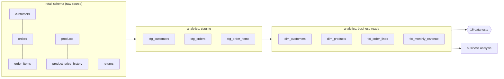
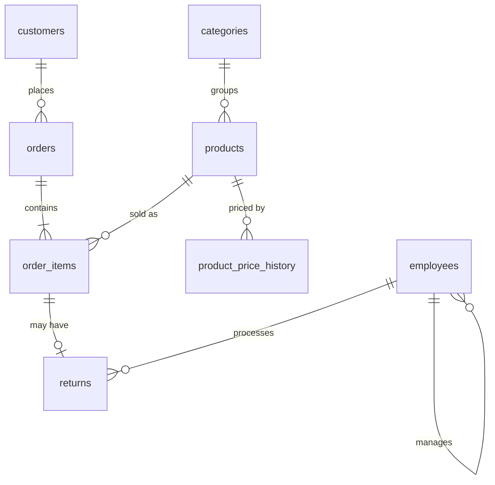

# Northbrook Outfitters: From Raw Retail Data to Tested, Business-Ready Models

An analytics engineering project in PostgreSQL. I took the raw transaction tables of an online retail store, built a layered set of documented models that analysts can query directly, protected them with 16 automated data tests, and used them to answer seven business questions.

**What this shows**

- **Data modeling:** a normalized source schema, plus staging, dimension and fact models, each with a stated grain
- **Tested SQL:** uniqueness, not-null, relationship, accepted-value, business-rule and reconciliation tests that fail loudly
- **Business-ready tables:** one agreed definition of revenue, profit and returns, so every report gives the same answer
- **Analysis:** cohort retention, RFM segmentation, promo profitability and channel value, written up as findings
- **SQL depth:** joins of every kind, `GROUP BY`/`HAVING`/`FILTER`/`ROLLUP`, correlated subqueries, recursive CTEs and window functions

---

## How the project is layered



| Layer | Models | What happens there |
|---|---|---|
| **Raw** (`retail`) | 8 tables | Data as the store's application writes it, flaws included |
| **Staging** | `stg_customers`, `stg_orders`, `stg_order_items` | Renaming, cleaning, typing. Emails are normalized and duplicate accounts are flagged and linked to the original. Money columns are computed once. |
| **Dimensions** | `dim_customers`, `dim_products` | One row per real customer (duplicates merged) with lifetime metrics. One row per product with category, margin and price tier. |
| **Facts** | `fct_order_lines`, `fct_monthly_revenue` | The single source of truth for revenue, profit and returns, at order-line and month grain |

The patterns mirror how dbt projects are organized (staging, then marts, then tests), written in plain SQL so the logic is easy to read without a framework.

## Data tests

`scripts/run_tests.sh` builds the models and runs [`tests/data_tests.sql`](tests/data_tests.sql). Each test counts the rows that break a rule, and the script exits with an error if any count is above zero, so it can gate a deployment in CI.

| Type | Examples |
|---|---|
| Uniqueness | Each model's grain is really unique, and no email appears twice after merging duplicates |
| Not null | Fact table keys are never null |
| Relationships | Every fact row joins to a customer and a product dimension row |
| Accepted values | Promo codes are from the known list |
| Business rules | No return dated before its order, no returns on cancelled orders, no refund larger than the charge, no overlapping price-history ranges, every price charged matches the list price in effect that day |
| Reconciliation | Monthly revenue totals equal order-line totals, and fact row counts match the raw source |

All 16 tests pass. I also confirmed they catch problems: changing a single order line's price makes the price-history test fail.

## The source data

Northbrook Outfitters is a fictional online store selling outdoor gear and home goods. The data covers **January 2024 to December 2025**.

| Table | Rows | What it holds |
|---|---:|---|
| `customers` | 1,506 | Profile, location, sign-up date, acquisition channel |
| `orders` | 5,069 | Date, status, sales channel (web or mobile app), promo code |
| `order_items` | 10,262 | Product, quantity, price at time of sale, discount |
| `products` | 63 | Price, cost, category, launch date |
| `product_price_history` | 90 | Every list-price change with effective dates |
| `returns` | 693 | Return reason, refund, the employee who processed it |
| `categories` | 6 | Camping Gear, Hiking Apparel, Footwear, Kitchen & Dining, Home Decor, Fitness |
| `employees` | 12 | Staff with a manager hierarchy |



The raw data has realistic flaws on purpose: 6 customers registered twice with differently capitalized emails, about 4% of customers have no address, 151 customers never ordered and 3 products never sold. The staging layer handles each one, and the tests prove it.

## Key findings

**1. Revenue grew 67% year over year, from $344K to $575K.** Active customers rose from 702 to 1,116. November and December bring in about a quarter of annual revenue.

**2. Footwear has a return problem.** Its return rate is 19.4%, more than four times every other category (about 4 to 5%), and "Wrong size" is the main reason. Footwear refunds total $32.9K, more than the next two categories combined. A size guide or fit tool is the clearest fix.

**3. The FLASH30 promo looks good on volume but loses on profit.** FLASH30 orders have the largest baskets ($238 average), but their gross margin falls to 36% compared with 56% for full-price orders, and 37% of them include a return (versus 12%).

**4. Referral customers are worth almost 3 times as much as paid-social customers.** Referred customers average $515 in lifetime profit and 6.2 orders. Paid-social customers average $183 and 2.4 orders, with the lowest repeat rate (67%).

**5. Repeat buyers drive the business.** 74% of revenue comes from repeat orders, and the top quarter of customers produces 53% of revenue.

**6. $197K of revenue sits with "at risk" customers.** RFM segmentation finds 243 customers who used to buy often (4.4 orders on average) but have not ordered in about 9 months. They account for 21.5% of revenue and are the best target for a win-back campaign.

**7. Half of orders now come through the mobile app.** Mobile share climbed steadily from 30% in Q1 2024 to 51% in Q4 2025, with order values on par with web.

## Project structure

```
sql-portfolio/
├── schema/01_create_tables.sql     Source tables, keys, constraints, indexes
├── data/02_seed_data.sql           Seed data (INSERT statements)
├── models/analytics_models.sql     Staging, dimension and fact models
├── tests/data_tests.sql            16 automated pass/fail data tests
├── queries/
│   ├── 01_basics.sql               Filtering, sorting, CASE, NULL handling, dates
│   ├── 02_joins.sql                Inner, left, anti, self and range joins
│   ├── 03_aggregations.sql         GROUP BY, HAVING, FILTER, ROLLUP
│   ├── 04_subqueries_ctes.sql      Correlated subqueries, EXISTS, chained and recursive CTEs
│   ├── 05_window_functions.sql     Ranking, running totals, LAG/LEAD, NTILE, moving averages
│   ├── 06_data_quality.sql         Exploratory profiling: nulls, duplicates, orphans
│   └── 07_business_analysis.sql    The seven business questions behind the findings above
├── .devcontainer/                  One-click GitHub Codespaces setup with PostgreSQL
├── GETTING_STARTED.md              Beginner-friendly guide to running the project
└── scripts/
    ├── setup.sh                    Creates the database, loads data, builds models
    ├── run_tests.sh                Builds models and runs the data tests (CI-friendly)
    └── generate_data.py            Reproducible data generator (Python, no dependencies)
```

## How to run it

[](https://codespaces.new/Kab-Vaj/retail-sql-analytics)

The quickest way needs no installation: click the button above. GitHub opens the project in your browser with PostgreSQL already running, the data loaded and the tests passed. To run it on your own computer with pgAdmin instead, follow the step-by-step [Getting Started guide](GETTING_STARTED.md).

If you already have PostgreSQL 13 or newer and are comfortable with a terminal:

```bash
./scripts/setup.sh          # create the database, load data, build the models
./scripts/run_tests.sh      # run all 16 data tests
psql -d retail_portfolio -f queries/07_business_analysis.sql
```

To regenerate the data (it is deterministic, so you get the same rows), run `python3 scripts/generate_data.py`.

## Design decisions

- **Every model states its grain.** Knowing that `fct_order_lines` is one row per order line and `dim_customers` is one row per real person is what keeps joins from silently double-counting.
- **One definition of revenue.** Net of line discounts, excluding cancelled orders, computed once in staging. Metric definitions that drift between reports are a common source of mistrust in data teams.
- **Clean in staging, never in the source.** Duplicate accounts are flagged and merged in the models, so the raw data stays an honest record of what the application wrote.
- **Prices are stored at the time of sale.** `order_items.unit_price` records what the customer paid, and `product_price_history` keeps every list-price change, so 2024 revenue is never recalculated at 2025 prices.
- **Views, not tables, for now.** At this data size views keep the models always current. In the warehouse project the same logic is materialized as tables and loaded incrementally.

## Connection to my data warehouse project

This database is the **source system** for my companion data warehouse project, which takes the same ideas further:

- `updated_at` columns on customers, products and orders allow **incremental loads** rather than full reloads.
- `product_price_history` feeds a **Type 2 slowly changing dimension** for products.
- `fct_order_lines` becomes the **sales fact table** of a star schema, with customer, product, date and channel dimensions.
- The staging rules and tests here carry over into the warehouse's load pipeline.

---

*Data is synthetic and generated for this project. Northbrook Outfitters is not a real company.*
